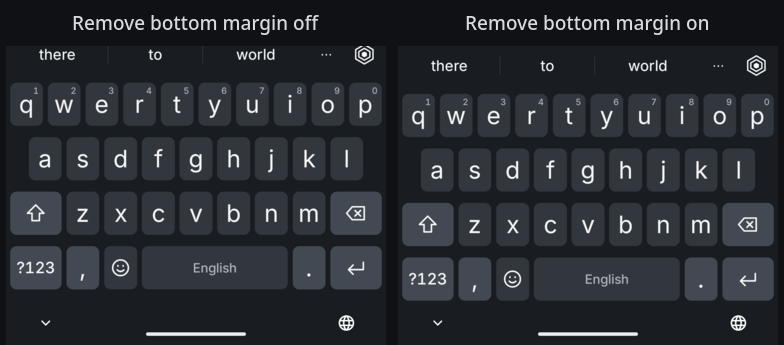
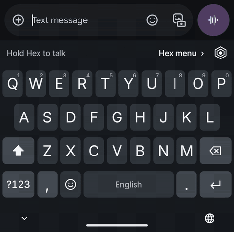
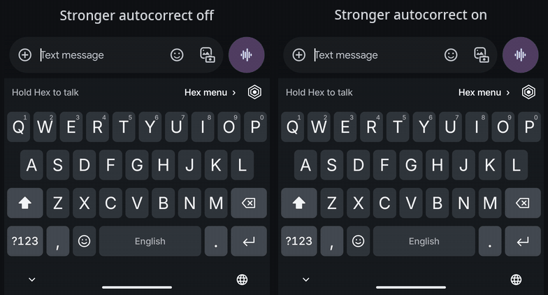
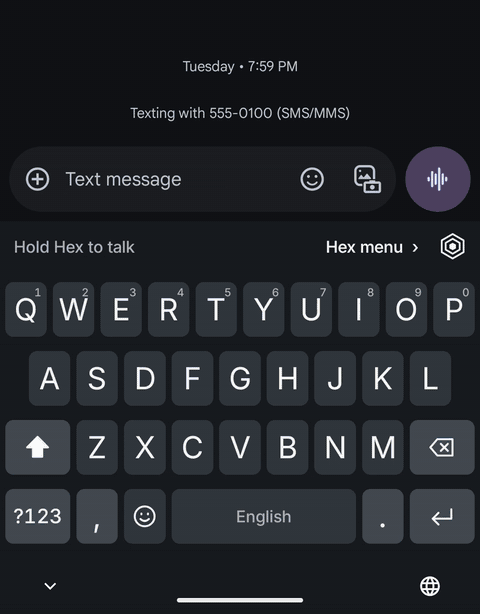
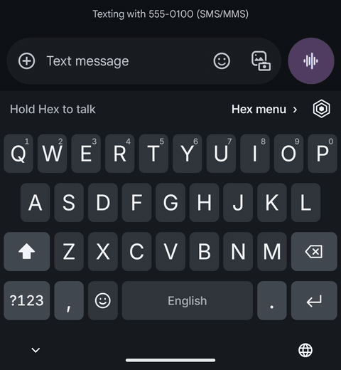

# Keyboard changes in this fork

This fork (`dgunay/hex`, branch `android-keyboard-tweaks`) adds keyboard features on top of upstream `dev`. They
came from switching to Hex's keyboard after SwiftKey and missing what it did. This page describes each one so it
can be rebuilt upstream without taking this code: what it does, where its switch is, why it exists, how it
works (the thresholds and Android APIs it relies on), its known limits, and its commit.

Every feature is off by default. Bug fixes are on for everyone and listed under [Fixes](#fixes), each saying whether
the bug is in upstream's code too, since those are the easiest to send upstream. The Android 17 voice hand-back is
also on, a fix that changes nothing for anyone who never hits the case (listed below). Each setting is a toggle in
**Settings › Keyboard**, or in Labs where it extends an existing lab. With everything off, the keyboard behaves as
upstream's does.

The demos were recorded on the Android emulator in dark mode; the circles are where a finger touched. Features that need sound, a microphone or the neural model have none.

Each setting's commits still use the names it had when it was added. Commit hashes are on the fork's branch and change when the branch is rebased; the subject lines stay the same.

## Layout

### Remove bottom margin

- **Switch:** Settings › Keyboard › Remove bottom margin (off). Changing it rebuilds the keyboard in place.
- **What:** removes the gap under the bottom row, so the bottom row's keycaps end where the system's navigation
  bar begins. With it off, they end Gboard's 12.2 dp above the bar, as upstream measured.
- **Why:** SwiftKey has no gap there. On a phone with gesture navigation, the gap makes the bottom row feel
  floating and pushes the space bar up.
- **How:** `KeyPlaneView.bottomExtra`, the extra height under the bottom row, becomes `-insetBottom`. That removes
  both the fixed bottom gap and the lower half of the row's own spacing, so the keycap's bottom edge meets the
  bar.
- **Commit:** `639df77d` Android Keyboard: Keys down to the bar removes the gap under the bottom row.

### More suggestions (Labs)

- **What:** with Labs › Keyboard › More suggestions on (off by default), the strip scrolls right to 8 more words past
  its three slots, for a word being typed, for the next word after a space (8 in all) and for an earlier word (8 in
  all).
- **Why:** the three slots hid likely words.
- **How:** `TypingWord.strip(more = 8)` returns the words past the slots in the same order. Upstream's `SteadyStrip`
  places the three slots, and `Suggestion.more` gives the rest; `StripView` lays the slots at the strip's width inside
  a `HorizontalScrollView` with the rest after them. A new word scrolls back to the start; the same word's next strip
  keeps the scroll.
- **Commit:** Android Keyboard: More suggestions (Labs).

### Hold delay (Labs)

- **Setting:** Labs › Keyboard › Hold delay, 100–600 ms in steps of 25 (300, upstream's fixed value).
- **What:** how long a key is held before its symbols and accents show (letters, period, comma on =<, the symbol
  pages and the number row). Holding the Hex key, or SwiftKey layout's comma, starts a dictation 50 ms after it,
  never sooner than 250 ms so a slow tap stays a tap: 350 ms at the default, as before.
- **Why:** upstream's 300 ms (Gboard's) is fixed; asked for to make held symbols quicker.
- **How:** `TypingPreferences.holdDelay`/`talkHold`, read at each press, in place of `KeyboardMetrics.HOLD_MS` and
  `TALK_HOLD_MS`.
- **Limits:** the space bar's long press (the language menu) keeps Android's own delay (Accessibility › Touch & hold
  delay).
- **Commit:** `d0ddec12` Android Keyboard: Hold delay (Labs).

### Shift changes a word's case (Labs)

- **Switch:** Labs › Keyboard › Shift changes a word's case (off).
- **What:** with the cursor at the end of a word, the one being typed or one already in the field, a shift tap cycles
  it lowercase → Title → ALL CAPS → lowercase ("sf", "Sf", "SF"), as Microsoft SwiftKey does. The strip offers its
  words in that case, and space keeps it as cased (no autocorrection). A word cased otherwise ("iPhone") goes to
  Title. Away from a word, shift is as before. The keys follow the word: ALL CAPS locks shift, so letters typed
  after it are capitals too, until the word ends (space, a mark, the cursor leaving it); the other cases leave shift
  off. The keys don't flash to capitals while shift is down for a recase.
- **Why:** asked for: a lowercase "sf" the strip offered only in lowercase, wanted as "SF". The keys following the
  word was asked for too: they went back to lowercase on every tap, whatever case the word was in.
- **How:** `KeyboardEngine.shiftDown`/`recase`: at a word, shift only holds (`ShiftState.hold`), so a letter typed
  while it is held is still a capital (a chord) and nothing recases; a tap recases as it lifts. The word being typed
  keeps its place (`TypingWord.recase`, literal from then on); one in the field becomes the word being typed again,
  as an undone autocorrection does. `WordCase` holds the cycle.
- **Limits:**
  - At a word, a tap no longer turns shift on for the next letter (hold shift for a capital mid-word: "iP"), and two
    quick taps there recase twice rather than lock caps. Caps lock still goes off with a tap.
  - Inside a word ("a‸i") a tap recases the whole word and the cursor stays put; shift then goes off. Before a
    word's first letter, or after its space, shift is as before.
- **Commits:**
  - `739c9e87` Android Keyboard: Shift changes a word's case (Labs)
  - `ad40800a` Android Keyboard: Shift's keys follow a recased word's case (Labs)
  - Android Keyboard: Shift recases a word with the cursor inside it (Labs)

## Fixes

The fork's fixes to upstream's code are upstream now (see [Dropped because upstream built it](#dropped-because-upstream-built-it)).

### A dictation's note gives the strip back

- **What:** a note in the keyboard's strip after a dictation ("No speech heard", "Stopped at 1 minute", a microphone
  or model error) goes after 5 seconds, or as soon as typing or a swipe offers words. Upstream keeps it until the next
  dictation or field, and it came back after a typed word was deleted, hiding the idle hint.
- **How:** `StripView` posts `noteExpiry` (`NOTE_MS`) when the note shows, and clears it when the strip has
  suggestions; `HexKeyboard.noteDone` puts back the idle hint. Voice-only mode's bar keeps its own 1.2 s.
- **Commit:** Android Keyboard: a dictation's note leaves the strip after 5 s or when you type.

### Fixes to this fork's own features

These are listed with their features; the bugs aren't in upstream's code.

- Neural autocorrect: a read space gave up on leaves the model's queue (`405f13ed`); see Neural autocorrect.
- Shift changes a word's case: the keys follow the recased word (`ad40800a`).
- More suggestions: next words and an earlier word's words scroll past three too (`9eb39c51`).

## Autocorrect

### Stronger autocorrect

- **Switch:** Settings › Keyboard › Stronger autocorrect, under Autocorrect (off).
- **What:** corrects sloppier typing. "embarasing", "neccesary", "convinience" and "restaraunt" (two slips each) are
  fixed, which upstream leaves as typed. The unit test's "kehbaodd" → "keyboard", typed on key centres, isn't fixed
  with real taps on the emulator (not yet looked into).
- **Why:** upstream's decoder allows one edit from a word, so a fast typist's long word with two slips is never
  fixed. SwiftKey fixes these.
- **How:** two changes in `SpatialDecoder`, both gated by its `strong` flag:
  - A word of six letters or more (`TWO_EDITS_FROM`) may be two edits from its reading instead of one.
  - A spelling that is no word at all costs 30 nats (`STRONG_UNKNOWN_COST`) instead of 22, so a real word a
    little further away can beat it.
  - The missed-space fallback (a letter typed where the space should be, "tonfind" for "to find") still competes
    with the best reading. Otherwise the higher cost lets a one-space split ("ton find") or a two-edit word
    ("fitness" for "itnwas") win first, and the fallback never runs. Split bench with Stronger on: stray-letter
    word errors 17.25% → 16.70% (11.98% → 11.63% with Neural autocorrect), plain sentences unchanged.
- **Limits:** more unusual words are changed too. For example, "tailscale" becomes "tail scale" and "gunay"
  becomes "Gun at", because a spelling the model doesn't know is now cheaper to replace. Learn new words (below)
  fixes this for words you keep.
- **Commit:** `89c7797a` Android Keyboard: Stronger autocorrect corrects sloppier typing.
  The fallback's contest: Android Keyboard: Stronger autocorrect still reads a letter typed for the space.

### Fix earlier words

- **Switch:** Settings › Keyboard › Fix earlier words (off).
- **What:** as SwiftKey does, put the cursor back into a finished word, by deleting back into it or tapping it,
  and the suggestion strip offers:
  - what you originally typed, if autocorrect changed it, and
  - other words its letters could be, judged by the words on both sides. "by" in "I want to by a car" offers
    "buy".

  Tapping one replaces the whole word. Choosing what you originally typed also tells autocorrect not to make that
  fix again, as undoing it with Delete does.
- **Why:** upstream only offers alternatives while a word is being typed. Once it's finished, fixing a wrong
  autocorrection or a real-word typo means retyping it.
- **How:**
  - `EarlierWord.at` finds the word around the cursor from the text before and after it (letters and
    apostrophes). It skips handles, paths, numbers and addresses (`@devin`, `src/main`, `abc123`, `anoma.ly`).
  - The field keeps its last 20 one-word autocorrections (`FIXES_KEPT`), so the strip can offer the original
    spelling.
  - The word's letters become taps on their keys' centres and are read by `SpatialDecoder.revisit` within the
    usual edit distance. Each candidate is scored with the language model against the previous word *and* the
    next word. Its search keeps 256 partial words at each letter (`REVISIT_BEAM`; typing keeps 48): with 48, a long
    word with one wrong first letter ("dandidate") lost "candidate" to cheaper dead ends and offered nothing.
  - Up to 3 candidates are shown (`REVISIT_WORDS`). Each must be within 10 nats of the word as it stands
    (`REVISIT_MARGIN`), so a word that fits ("the" in "on the table") offers nothing.
  - Replacing the word selects it with `setSelection` and commits the new one in a batch edit. A space follows it
    as after any pick, unless the text after already separates it (a space or a closing mark): then the cursor
    stays before that space, and the next word typed takes it.
- **Limits:**
  - It never shows in password fields, `TYPE_NULL` editors, number pads, or while symbols show.
  - Splits and joins ("deli ate" → "delicate") aren't remembered, since they change more than one word.
- **Commits:**
  - `9446017d` Android Keyboard: Fix earlier words offers other words for one you go back to
  - `639fd350` Android Keyboard: Fix earlier words reads the whole sentence with Neural autocorrect
  Its pick's space: Android Keyboard: Fix earlier words' pick takes its space as any pick does.
  The wider search and the model's order: Android Keyboard: Fix earlier words reads the whole sentence with Neural
  autocorrect.
- **With Neural autocorrect:** the model ranks the words for one you went back to by the whole sentence, the words
  after it as well as before. Each reading is scored with the rest of its sentence after it ("buy a new car this
  weekend.", up to 80 characters), weighed against its taps as typing weighs it (1.5), and offered only within 10 of
  the word as it stands, as the pairs' margin. The pairs' strip shows at once; the model's replaces it when it
  answers, in the background. Its likeliest may be one the pairs left out (it reads 8 within 20).
- **Benchmark:** `EarlierWordsBench` (run with `HEX_BENCH_EARLIER=1`): the gate's 2,000 held-out sentences, each
  word the synthetic taps typed wrong (3,127), gone back to with the rest of the sentence right; and 1,074 words typed
  right.

  | | Meant word first | In the strip | Offers on a right word |
  |---|---|---|---|
  | Before (beam 48, pairs) | 81.8% | 84.9% | 31.0% |
  | Beam 256, pairs | 88.4% | 92.5% | 32.8% |
  | Beam 256, model | 92.6% | 93.3% | 11.8% |

  Most of what's still missed has no reading within one edit (two typos, names). The taps are synthetic, not
  recorded.

### Learn new words, more ways (Labs)

- **Setting:** upstream's Labs › Keyboard › Learn new words, which learns a word when you tap it as typed or keep it
  after undoing its fix. With it on, this fork adds:
  - **Long-press to remove:** long-pressing one of your own words in the strip (or in More suggestions' scroll)
    offers `Tap to remove “gunay” from your dictionary`. That also takes it out of Labs › Keyboard › SwiftKey words if
    it came from there.
  - **Fix earlier words:** choosing what you first typed there learns it, as tapping it in the strip does.
- **How:** `KeyboardEngine.ownsWord` (your personal words), `HexKeyboard.offerForget`/`forgetWord` (deletes the
  dictionary rows `COLLATE NOCASE`, in every language), and Fix earlier words' pick calls upstream's `learn`.
- **Commit:** Android Keyboard: Learn new words, long-press removal and Fix earlier words.

### Neural autocorrect (Labs)

- **Switch:** Labs › Keyboard › Neural autocorrect (off). On, it offers a one-time 145 MB download. The row then
  shows Ready, a Test speed action, and how long space has waited for the model while you typed.
- **Model choice:** with GGUF models copied into the app's `no_backup/neural-models/` folder, a Model row offers them
  in a dropdown beside the downloaded SmolLM2-135M, to try a fine-tune in real typing. Nothing downloads them; on this
  debug build they're copied with `adb push model.gguf /data/local/tmp/` and
  `adb shell run-as ly.anoma.hex cp /data/local/tmp/model.gguf no_backup/neural-models/`. A change takes effect at the
  next word (`NeuralModels`, `TypingPreferences.neuralModel`); the typing log notes which model loaded. Speed test
  uses the chosen one. Commit: Android Keyboard: Neural autocorrect can use a model copied onto the phone (Labs).
- **Fine-tuned model (local, not shipped):** SmolLM2-135M fine-tuned on chat-like text reads casual typing better.
  The model on the phone is the one taken after 5M tokens of training.
  - Recipe: 4M short texts, each one starting at the scorer's start token, like a field's text before a word:
    45% Discord-Dialogues messages, 25% SODA dialogue lines, and 30% FineWeb-Edu runs of 1–3 sentences (to keep
    tidy prose). Full fine-tune, lr 1e-4, 6,144 tokens per batch, texts cut at 128 tokens, on one consumer GPU
    (~2,500 tokens/s, about 35 minutes to 5M). Then converted to q8_0 GGUF (145 MB, the same size as the download).
  - Results (word errors %, autocorrect weight 1.5; lower is better):

    | Test set | Word pairs | SmolLM2-135M | Fine-tuned, 5M | 10M | 20M |
    |---|---|---|---|---|---|
    | Tidy sentences | 4.90 | 3.34 | 3.41 | 3.40 | 3.44 |
    | Discord | 7.28 | 5.53 | 4.57 | 4.65 | 4.59 |
    | SMS | 7.17 | 6.21 | 5.64 | 5.57 | 5.73 |
    | Spoken dialogue (SODA) | 2.92 | 2.02 | 1.72 | 1.66 | 1.71 |

    Longer training didn't help, so 5M it is. Chat-only training (no FineWeb-Edu) did as well on chat (SMS 5.44)
    but worse on tidy sentences (3.54). Of the bigger bases, not fine-tuned: Gemma 3 270M is a little better on
    tidy sentences (3.27) and SODA (1.66) but worse on Discord (5.03) and SMS (5.95), and its benchmark ran about 3×
    as long; SmolLM2-360M (4.94 Discord, 5.90 SMS) is about 2× as slow; Granite 4.0 350M did worse than word pairs.
  - Scripts, test sets and the data's sources: `benchmark/neural/` (its README). The data and checkpoints (~16 GB)
    stay out of git, in a local work folder.
- **What:** English autocorrect decides with a small language model that reads the text before the word (the
  keyboard's last 96 characters), instead of only the word before it. It picks the reading that fits the sentence,
  and it can tell a real word it has never seen ("tailscale") from a typo, because it scores words piece by piece
  rather than looking them up.
- **Why:** upstream's decoder scores each reading with word pairs (a bigram model). That can't use more than one
  word of context and gives every unknown spelling the same flat cost, so names and tech words get split or
  "corrected". Gboard (2024) and iOS 17 both moved to neural language models for this.
- **How:**
  - The model is Hugging Face's SmolLM2-135M (Apache-2.0), 8-bit GGUF, pinned by revision, size and SHA-256 in
    `ModelStore.neural`. It runs in llama.cpp v1.0.0 (pinned by commit and SHA-256), built into a library of its
    own, `libhextyping.so`, like Faster English dictation's. Two patches keep the keyboard's process from
    starting a debugger or loading code from a path (`ggml-no-debugger.patch`, `llama-no-dlopen.patch`).
  - It's a noisy-channel decoder. The taps' cost of each reading stays as upstream computes it. Only the
    word-pair part is replaced by the model's cost in nats, −log P(word | text before) − log P(the word ends
    there), weighed 1.5 (`neuralWeight`). The end-of-word term keeps a prefix ("tail") from beating the whole
    word. Margins and every other rule are unchanged.
  - When space finishes a word, the model scores the spelling as typed and the 9 cheapest readings
    (`NEURAL_READINGS`) in one batch. Readings that begin alike share their tokens (a tree), each word's
    sequence copied from the context's cache. The missed-space fallback ("thankyou" → "thank you") is taken
    only where the model rates the split no less likely than the spelling.
  - Run-together words, only with the model: a letter typed where the space was ("thatshcrazy" → "that's
    crazy") reads as two words spelled as typed around it, at 4 nats more than a missed space
    (`strayLetterCost`), never where that letter finishes a contraction ("canthappen" stays "can't happen").
    The halves, and the words of a run of three or more ("thatssocrazy" → "that's so crazy"), may be
    contractions typed without their apostrophe. The model then judges the split against the spelling, as
    before: "tailscale", "kubernetes", "wireguard" and 20 other tech words checked stay whole.
  - The model reads the text before a word while its first letters are typed (`prepare`), so space only decodes
    the readings. The context's start moves 200 characters at a time, so the cache holds between words.
  - Space waits for it at most 90 ms (`neuralBudget`). Without an answer by then, or before the model has
    loaded, the word pairs decide as with the switch off. The model loads on the first word once the switch
    is on, runs on 2 threads at display priority, and is freed after 5 idle minutes.
  - Swipes too: when the finger lifts, the model scores the swipe decoder's 12 cheapest readings (one batch),
    written as they'd go in, in place of their word pairs, weighed 1.0 (`SwipeReader.neuralWeight`). A loose
    swipe, one whose best fit still costs more than 1.5 a letter (corners cut, "supposed" as a line back and
    forth), has its path cost weighed 0.5 (`neuralPath`, `neuralLoose`), so the sentence counts for more; a
    tidy one's counts in full. It starts reading the text before when the finger goes down. The preview while
    the finger moves still uses the pairs.
  - Completions while a word is typed: at each letter the model reads, without waiting, the word pairs' few
    completions after the word before and the commonest words with those letters, 24 in all, in two batches
    (`TypingWord.rankCompletions`, `NeuralScorer.costsLater`). The second batch is its own task, so a word space
    finishes meanwhile is read first; a newer letter's request takes the place of an older one's. Once answered,
    the strip's completions go likeliest in the sentence first, in whichever strip shows ("We were probably go"
    offers "gonna"); after the pause the likeliest stays beside what space puts in, ahead of the taps' other
    readings ("gon": "gone", then "gonna"). Space then finds the finished word already read.
  - Next-word predictions after a space mid-sentence: the same, for the word pairs' likeliest after the word before
    and the commonest words, 24 in all, read with the whole text before (`TypingWord.rankPredictions`): "I need to
    pick up my" no longer reads only "my". Held-out sentences (2,375 next words): the next word is among the 3 for
    20.1% → **29.3%**, first for 10.7% → **20.2%**.
  - A tapped word you taught the keyboard (Learn new words, your own words) never costs more than it did without
    the model, which barely knows it: it takes the cheaper of the two. A swipe spells nothing to keep, so there
    your words get the model's cost: with thousands of imported SwiftKey words, a vague path would otherwise
    read as one of them.
- **Measured:**
  - English quality gate (2,000 held-out sentences of noisy taps, `quality-gate.py en --neural MODEL
    --neural-lib LIB`): word errors left 4.90% → **3.34%** (reduction 85.50% → 90.13%), correct words changed
    0.32% → **0.05%**. Swipes (`swipe-bench.py en --neural MODEL --neural-lib LIB --neural-weight 1.0`, 12,515
    held-out swipes with the sentence before): first word right 96.9% → **98.1%** (in the strip 99.7% either
    way); 1.0 was the best of 0.5, 1.0 and 1.5 on even sentences and held on odd ones (96.8% → 98.0%). On
    sloppier synthetic paths (`--noise sloppy`, and `vague`, which cuts corners hardest): **82.0% → 89.3%** and
    **77.0% → 85.7%**, against 87.3% and 83.4% with the path weighed in full; tidy paths keep 98.1%. The loose
    rule was chosen on even sentences from each swipe's readings (`--neural-dump`), against fixed weights 0.35–1.0
    and smooth ones; a fixed 0.5 gains about as much on sloppy paths but tidy ones fall to 97.2%. A swipe takes
    33 ms median on the host (45 ms 99th percentile). Run-together words (`split-bench.py`, the gate's sentences
    with one space dropped or typed as a letter): word errors with a dropped space 7.71% → 7.67%, with a stray
    letter 15.7% → **12.2%** (sentences all right 39% → 52%; the word pairs alone 13.1% and 20.5%), the gate's
    own sentences unchanged. Completions (400 held-out sentences, words of 4 letters or more, the strip's 3 slots):
    after 1 letter 25.4% → **43.1%** offer the word, after 2 51.6% → **72.0%**, after 3 80.4% → **91.2%** (12
    candidates, one batch, gave 36.7%, 66.2%, 88.9%). The larger SmolLM2-360M and Qwen3-0.6B were no better on the gate before tuning
    (3.92%, 4.11%), and are 2.7× and 4.4× the download.
  - Galaxy Z Flip6, `hextyping-cli MODEL --bench 2`: an ordinary word 15 ms (95th percentile 19–23 ms); a word
    with 10 readings 46 ms; reading the text before a word 8 ms. Warm and at 19% battery, the same took 20, 28,
    75 and 12 ms. 4 threads were faster typically but stalled up to 200 ms; 6 were slower.
  - Memory: 224 MB while loaded. The weights are read, not mapped: the CPU backend keeps a repacked copy for its
    dot-product kernels (twice as fast), and a mapped file stayed resident beside it (334 MB).
- **Asked ahead:** after each letter, once the strip is drawn, the decoder makes the decision space would make
  now, with a stand-in scorer that only notes the words it would ask the model about (`TypingWord.prescore`). Those
  are read in the background, before the strip's, so space usually finds every cost already read and waits for none.
  The costs are the model's for the same words after the same text, so the correction is the same
  (`theWordsSpaceAsksAboutAreAskedAhead`). A missed space's reading, which space only asks about after the model's
  first answer, still waits. Background reads go 4 words at a time (12 before), so a space typed straight after a
  letter waits behind at most 4.
- **One change per pause:** the strip no longer shows the word pairs' order and then reshuffles into the model's.
  - While a word is typed, each letter shows what was typed at once, beside the words already showing that still
    start with the letters (none as a fix).
  - After 150 ms without a letter (`NEURAL_PAUSE_MS`, about the median gap between keys in the typing log), the
    model is asked for the order, and the strip changes once, when it answers. That also saves power, since fast
    typing no longer asks after every letter.
  - Next words after a space wait for the model too, with the strip empty meanwhile.
  - Without an answer in 200 ms (`NEURAL_WAIT_MS`), the strip shows the word pairs' order, and a later answer
    waits for the next letter.
  - The readings space asks about are still asked after every letter, so space's correction is unchanged.
  - Commit: Android Keyboard: Neural autocorrect's strip changes once, when the model answers.
- **Too late:** a read space gave up waiting for leaves the worker's queue if it hasn't started, so it never holds up
  the reads behind it (the strip's, the next word's).
- **Limits:**
  - English only. It needs the 145 MB download and keeps 224 MB in memory while loaded.
  - The weight isn't tuned yet, and the gate's short Tatoeba sentences can't show what longer context or
    unknown words gain. A messages-style test set with names and tech words is still to be made.
  - Next-word predictions at a sentence's start or after a comma keep
    their fixed lists.
  - A stray letter splits only between two words spelled exactly as typed: with a typo in either half
    ("youbkger" for "you over") it doesn't.
  - Completions come from the 24 commonest words with the letters typed (and the word pairs' few): one rarer
    than that ("gonna" for "g") shows only once more letters leave it among them.
  - Built for ARMv8.2 with dot product (every recent phone). Emulators that translate ARM can't run it.
- **Commits:**
  - Android Keyboard: Neural autocorrect, a small language model reading the sentence (Labs)
  - `99445880` Android Keyboard: Neural autocorrect reads the word's readings before space
  - `405f13ed` Android Keyboard: Neural autocorrect drops a read space gave up on

## Emoji

### Emoji shortcodes (Labs)

- **Switch:** Labs › Keyboard › Emoji shortcodes (off).
- **What:** type a colon and a name, such as `:fire`, and the strip offers its emoji (🔥, then others the name
  starts or describes: `:piz` offers 🍕). Tap one to put it in place of the `:name`, or type the closing colon
  (`:fire:`) for the emoji the name names exactly.
- **Why:** finding an emoji meant scrolling the AndroidX picker's categories by eye. iPhone Hex has the same lab.
- **How:**
  - `typing/EmojiIndex.kt` reads iPhone Hex's emoji index (`assets/emoji/index-en.txt`, copied from
    `ios/HEXShared/FullKeyboard/Emoji/emoji-index-en.txt`: Unicode's names and CLDR keywords, Unicode License v3,
    plus Hex's chat words), loaded the first time a shortcode is typed. Emoji newer than Android 12's Emoji 13.1
    are kept only where the phone's font draws them.
  - `EmojiShortcode` ports iPhone Hex's rules: a token is a colon after whitespace or the field's start, then a
    name of two or more letters or digits, so `abc:pizza`, `:p`, `:-D` and `10:30` stay text. Exact names and
    aliases come first, then the names and keywords the token starts, one emoji per family.
  - `KeyboardEngine` shows them in the strip after each key, takes a pick over the token, and puts in the exact
    match on a closing colon.
- **Limits:** English names only. Your use doesn't rank them yet.
- **Commit:** Android Keyboard: Emoji shortcodes (Labs).

### Emoji search (Labs)

- **Switch:** Labs › Keyboard › Emoji search (off).
- **What:** a 🔍 key in the emoji panel's bottom row, between ABC and the space bar. Tapping it brings back the
  letter keys under a grid of the emoji found (two and a half rows, scrolling), with a search line in the strip:
  a back button and what you've typed. The grid re-sorts with each letter; before one, it holds Recently used (or
  the smileys). Tap one to put it in; the search stays for another. Back returns to the panel; Return or the emoji
  key ends it.
- **Why:** the AndroidX picker has no search, and can't be given one. Gboard and iPhone Hex search.
- **How:** `KeyboardEngine` holds the search while it runs: letters, digits, space, delete (held: a word) and
  Return edit it instead of the field, and a swipe does nothing. `EmojiIndex.search` (iPhone Hex's rules: each
  word must start a word of the emoji's name or keywords; whole name words first) finds up to 60. `EmojiSearchGrid`, between the
  strip and the keys, shows them. A found emoji goes into the panel's Recently used.
- **Limits:** English words only. Your use doesn't rank the results.
- **Commits:**
  - Android Keyboard: Emoji search (Labs)
  - `3f90b3f7` Android Keyboard: Emoji search shows its results in a grid above the keys

## Dictation

### Dictation sounds volume (Labs)

- **Setting:** Labs › Dictation sounds › Sound › Volume, 5–100% in steps of 5 (100% to start). It shows on the Sound
  page above the sets while Dictation sounds is on.
- **What:** upstream's Dictation sounds play at the System volume's level; the slider sets them below it. Moving it plays
  the chosen set's stop sound once per step.
- **How:** `DictationSounds` plays at `KeyClick.scalar(percent)`, Key click volume's curve (every 10% is 3 dB less),
  read as each dictation starts and on each audition. The setting is `soundVolume`, the same key the fork's own
  Dictation sounds used, so a level set there carries over.
- **Commit:** Android: Dictation sounds volume (Labs).

## Dropped because upstream built it

- **A clause mark takes autocorrect's space** ("keyboadr", space, "." gave "keyboard." instead of "keyboard .").
  Upstream added the same behaviour as Labs › Keyboard › Punctuation after autocorrect (#2814, off by default), so
  this fork dropped its own always-on version and uses upstream's lab.
- **Haptic strength** (a 10–100% slider for key taps). Removed from the fork as unneeded.

Upstream merged these from this fork's issues on 2026-11-28; the fork dropped its own commits for them and uses
upstream's. Where upstream's differs from what the fork had:

- **English typing with `en.spellings`** (#2999): the same one-word fix.
- **Delete words when held** (#3015): now Labs › Keyboard, off. The timings are fixed at the fork's defaults
  (500 ms to the second word, each next 20% sooner, never under 90 ms); the fork's Initial delay and Acceleration
  sliders are gone.
- **Key click volume** (#3014): now Labs › Keyboard, off. Same 5–100% slider and 3 dB per 10%; dragging it plays one
  click per 5% step instead of a steady repeating click.
- **Click when a hold opens** (#3013): the same, and it also clicks when a flick opens the options at once (SwiftKey
  layout's period), which the fork's didn't.
- **Space after punctuation** (#3002): what the fork had as the always-on "A comma after a picked word keeps the
  space after it" is now Labs › Keyboard › Space after punctuation, off.
- **Closing quotes take the space** (#3012): now Labs › Keyboard, off (the fork's was always on). It works on the
  standard layout too: it reads only the text, so the space survives the switch to ?123, which the fork's didn't.
  It never takes a space right after the opening quote or one of several spaces.
- **Strip taps that did nothing where text follows the cursor** (#3016): the same three cases, on for everyone.
- **Steadier suggestion strip** (#3026): upstream's `SteadyStrip`, on for everyone, keeps a shown word in its slot
  while the word is typed and lays an unknown word out with what was typed on the left before the pause, as the fork
  did. It also keeps what was typed on the left once it showed for that word, even when the pause finds no fix.
  More suggestions stays the fork's own.
- **SwiftKey layout** (#3028): Labs › Keyboard › SwiftKey layout, the same symbols, bottom row, pages, one-row period
  with its flicks, and the comma's held dictation with a microphone hint. The comma's dictation hold follows this
  fork's Hold delay.
- **Learn new words** (#3030): now Labs › Keyboard, off (the fork's was in Settings › Keyboard). An undone fix is
  learned only once that same word ends unchanged (space or a closing mark), so holding Delete never teaches a typo;
  the fork's learned it at the undo. Words must use only the language's own letters (no hyphens). The fork keeps
  [its extras](#learn-new-words-more-ways-labs).
- **Delete words when held's timing sliders** (#3033): Initial delay and Acceleration, the fork's ranges and
  defaults, under upstream's own setting names, so a level set in the fork doesn't carry over.
- **Dictation sounds** (#3024): the same seven sets, cues and zeroed start, Labs › Dictation › Dictation sounds, off;
  upstream packs desktop's own WAVs at build time instead of copies. It had no volume; the fork keeps that as
  [Dictation sounds volume](#dictation-sounds-volume-labs).
- **Voice-only mode answers apps' speech requests, and the Android 17 hand-back** (#3027): now its own lab, Labs ›
  Keyboard › Answer apps' speech requests, off; the fork's came on with Voice-only mode. The same sheet and the same
  hand-back timing (insets plus 50 ms, at most 400 ms). The activity has a new name, so the choice of which app
  answers speech may need making again.

## This fork's builds

- Settings' main page names the fork, branch and commit a build came from, and Send feedback is gone, so reports
  about this fork's builds don't reach upstream (`031e0239` Android: Settings' main page names the fork, branch and
  commit it was built from; `d2a08c95` Android: no Send feedback in this fork's builds).
- This page (`3667f4e0` Android: FORK_CHANGES.md lists this fork's keyboard changes).

## Diagnostics

### Typing log (Labs)

- **Switch:** Labs › Keyboard › Typing log (off), with Delete typing log and its size below it.
- **What:** a plain-text log, on the phone only, of every key (and where it was tapped), strip pick, swipe, delete,
  cursor move and suggestion strip, each with the text around the cursor after it, the word being typed, the
  autocorrection Undo would take back, and which space rules are pending. The Hex menu's **Mark a problem** writes a
  marker with the text as it is then, and then a box above the strip asks what went wrong (optional). The keyboard types into
  it as into any field (cursor, autocorrect, suggestions, delete) while the app's field waits untouched; Return or ✓
  keeps the note in the log after the mark, and ✕ drops it. Settings changes and each field's app and input type are logged too.
- **Why:** to find the spacing and punctuation papercuts from a day of natural typing instead of from descriptions.
- **Privacy:** password fields and fields that ask keyboards not to learn (incognito) are never logged, not even
  their keys. Files are in the app's private storage (`files/typing-log/`), read with
  `adb shell run-as ly.anoma.hex cat files/typing-log/*` on this debug build. Up to 200 MB, oldest files dropped.
- **Model timings:** with Neural autocorrect on, it also logs how long space waited for the model (how long its word
  queued and what it queued behind, how long it ran, for how many words) and each strip batch's and context read's
  time, so the delay felt while typing can be taken apart. Timings only, no text.
- **How:** `TypingLog` writes lines on its own thread. `KeyboardEngine` posts a snapshot after each entry point
  (`logAfter`), so it sees the text as the event left it; `StripView` logs each strip.
- **Limits:** a line is two extra reads of the field's text per event, so typing is a little slower while it's on.
- **Commits:**
  - Android Keyboard: Typing log (Labs)
  - `1c062d8d` Android Keyboard: Typing log records the neural model's timings
  - `3deb9395a` Android Keyboard: Mark a problem takes a note of what went wrong (Labs)
  - Android Keyboard: Mark a problem's note is a box the keyboard types into
